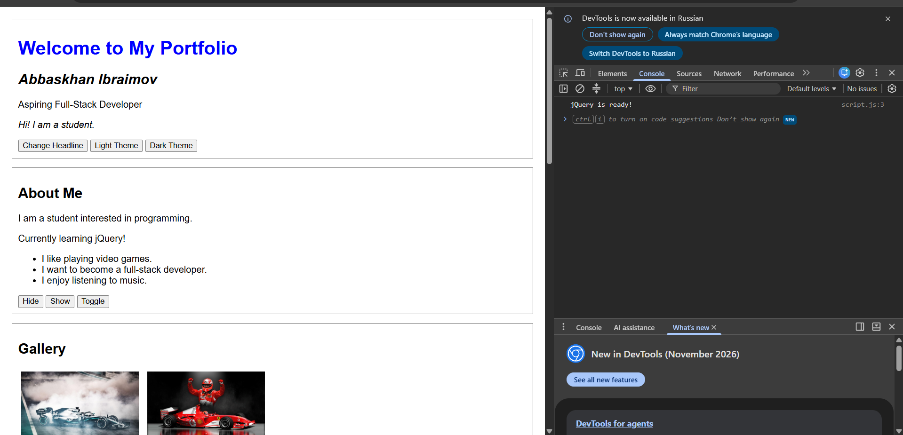
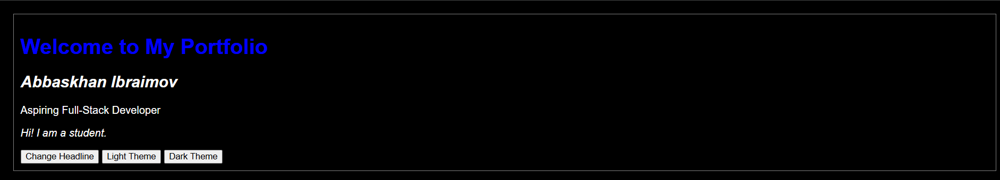
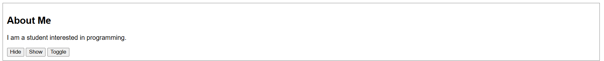
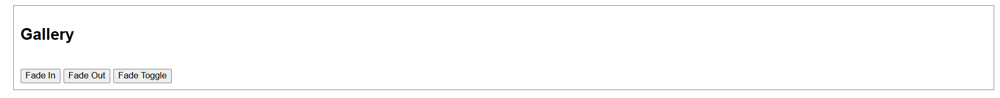
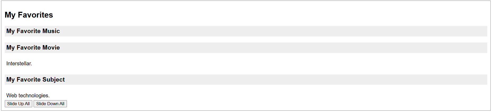
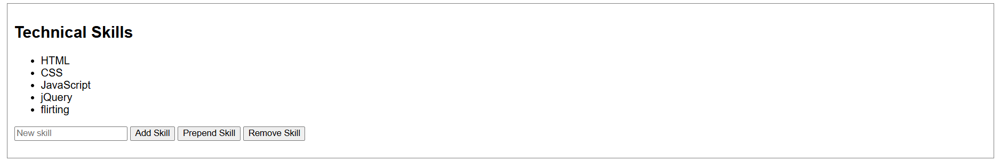
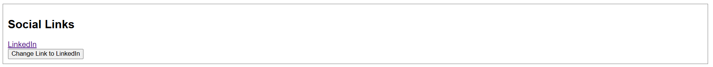
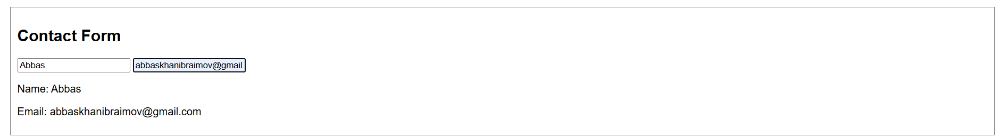
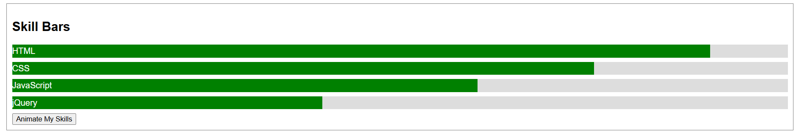

# Assignment 6. jQuery
Ibraimov Abbaskhan
IT-2501

## Part 1. Getting Started with jQuery

### Task 0. Setup
jQuery is included from CDN, $(document).ready` prints jQuery is ready! in the console.

Screenshot:

### Task 1. Selectors & CSS
Tag, ID and class selectors, .text()`, `.html()`, `.css()`, light/dark theme buttons.

Screenshot:

## Part 2. jQuery Effects

### Task 2. Visibility Methods
Hide, Show, Toggle buttons for the status message and fun facts.

Screenshot:

### Task 3. Fade Methods
Gallery with .fadeIn() .fadeOut() .fadeToggle().

Screenshot:

### Task 4. Slide Methods
Three clickable headings with panels, .slideUp() .slideDown() .slideToggle().

Screenshot:

## Part 3. DOM Manipulation with jQuery

### Task 5. Add & Remove Elements
Skill list with .append() .prepend() .remove(), empty skills are not allowed.

Screenshot:

### Task 6. Modifying Attributes
Button changes the link with .attr().

Screenshot:

### Task 7. Form Interaction
Live output of Name and Email using .val() .text()`.

Screenshot:

## Part 4. Animations

### Task 8. Basic Animation
Skill bars start at zero width, Animate My Skills animates them to different levels with .animate()` and back to zero on the second click.

Screenshot:

## Summary
I created a single page portfolio using HTML, CSS and jQuery. I completed the tasks one by one, tested each of them in the browser, and uploaded the project to GitHub and GitHub Pages.